# mhd-boris

2.5D Constrained Transport Magnetohydrodynamics with a Boris correction

Philip Mocz (2024), [@PMocz](https://x.com/PMocz)

The base-scheme is based on
[algorithm write-up](https://levelup.gitconnected.com/create-your-own-constrained-transport-magnetohydrodynamics-simulation-with-python-276f787f537d)

The Boris correction follows Matsumoto, Miyoshi & Takasao (2019),
[arXiv:1902.02810](https://arxiv.org/abs/1902.02810) -- we solve their
equations (1) -- (8).

The goal: cap the Alfven speed so the CFL timestep gets bigger, **without
changing the solution too much**. The two questions a run has to answer are
*how much speedup did I buy* and *how much did the solution change*.


## How to Run

```bash
python mhd-boris.py <prob_id> <c_limit> [options]
```

`c_limit` is the reduced speed of light; pass `inf` to switch the correction off
and recover ideal MHD. Useful options: `-N` resolution, `-s {hll,llf,hlld}`
Riemann solver, `--no-plot` for batch runs, `--t-end`, `--courant`,
`-o` output directory. `--help` lists them all.

Problems: `1` Orszag-Tang, `2` circularly polarized Alfven wave, `3` field loop,
`4` Orszag-Tang with a strong out-of-plane guide field.

Reproduce everything below with:

```bash
for c in inf 2.4 2.2 2.0 1.8 1.6;              do python mhd-boris.py 1 $c --no-plot; done
for c in inf 32.0 16.0 8.0 4.0 2.0 1.0 0.5;    do python mhd-boris.py 2 $c --no-plot; done
for c in inf 16.0 12.0 8.0 6.0;                do python mhd-boris.py 4 $c --no-plot; done
python analysis.py
```


## Finding Summary

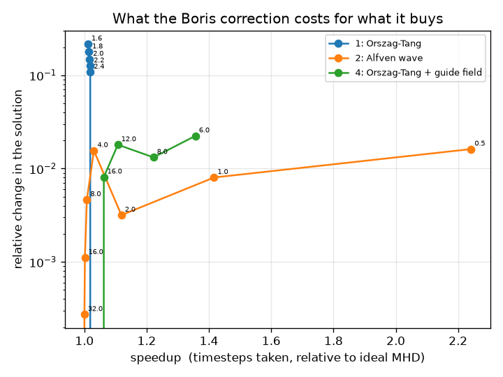

| problem | c_limit | speedup | solution change |
|---|---|---|---|
| Orszag-Tang | 2.4 | 1.02x | 10.8% |
| Orszag-Tang | 1.6 | 1.01x | 21.6% |
| Orszag-Tang + guide field | 8.0 | 1.22x | 1.3% |
| Orszag-Tang + guide field | 6.0 | 1.36x | 2.2% |
| Alfven wave | 1.0 | 1.42x | 0.8% |
| Alfven wave | 0.5 | 2.24x | 1.6% |

**Plain Orszag-Tang is the wrong test problem for a Boris correction.** It has
`v_A ~ a ~ |v| ~ 1.6`, so the CFL limit is set by the *flow speed*, not the fast
speed, and capping `v_A` buys essentially nothing -- 1-2% fewer timesteps for a
10-20% change in the solution. That is all cost and no benefit, and no amount of
implementation work changes it.

Boris pays off only where `v_A >> max(a, |v|)`, i.e. at low plasma beta. Problems
2 and 4 are in that regime and get 1.4-2.2x for a ~1-2% change.

Every run now prints `dt/dt_mhd`, the speedup the correction is actually buying
at that instant, so you can see immediately whether it is worth switching on.


## 1. Orszag-Tang

Timesteps:

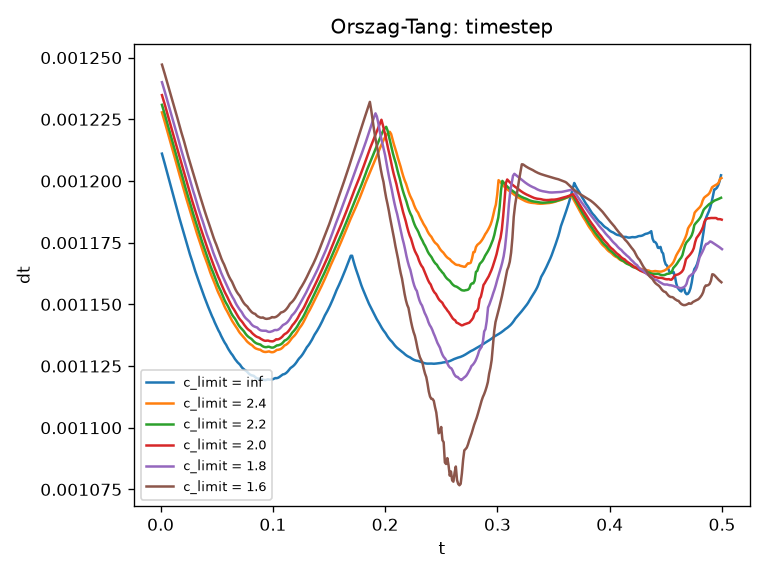

Density (leftmost panel is ideal MHD, then decreasing `c_limit`):

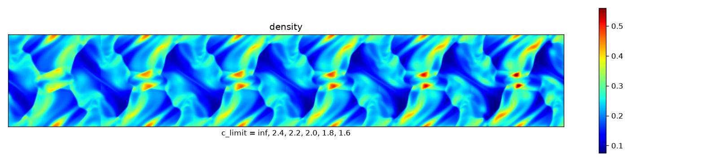

Magnetic pressure:

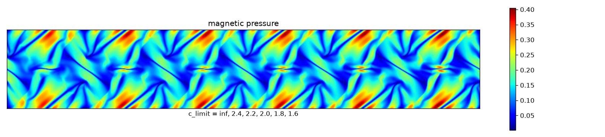

Velocity:

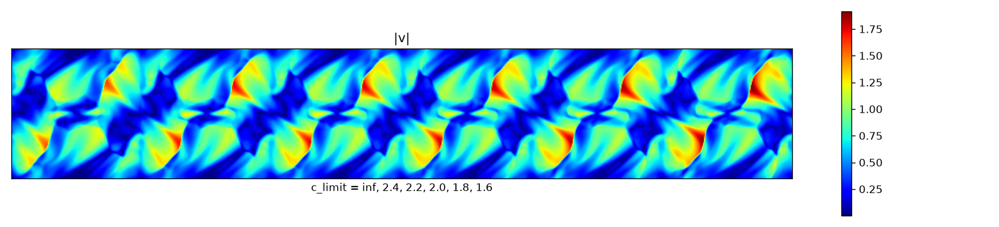

Alfven speed:

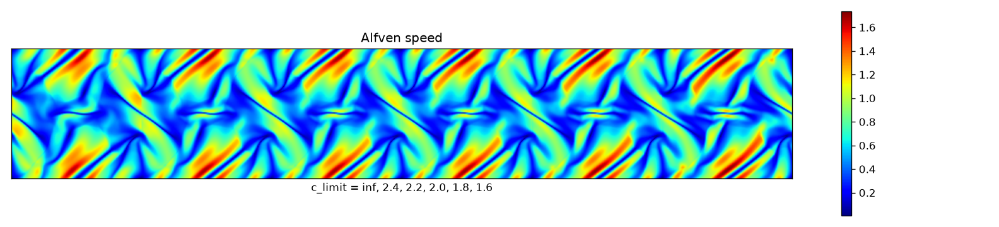

Fast speed:

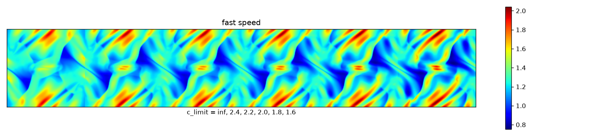

Note that `c_limit = 1.6` is *below* `v_max ~ 1.6` and drives the gas pressure
negative; the code warns about both. See "When it breaks" below.


## 2. Alfven wave

A circularly polarized Alfven wave keeps `|B|` (and therefore `rho_A`) uniform
and constant, so it stays an **exact nonlinear solution of the Boris system**,
just travelling at the reduced speed `gamma_A * v_A`. That makes it a sharp test:
the amplitude must not move at all.

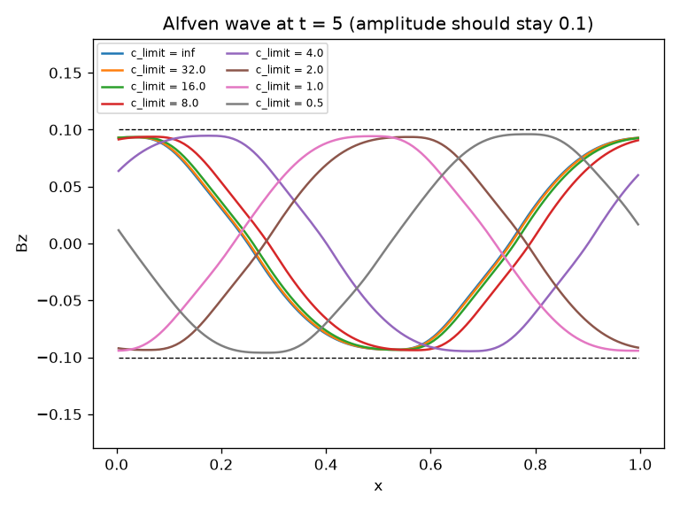

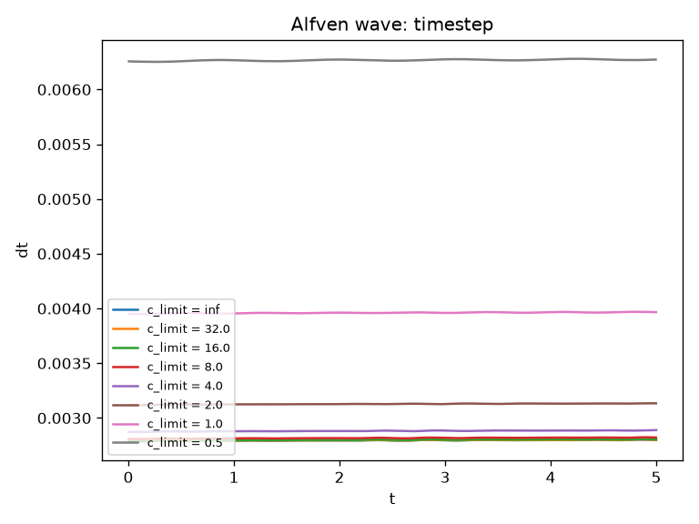

Measured propagation speed matches `gamma_A * v_A,x` to within 0.03% for every
`c_limit` down to 0.5, and the amplitude is held to better than 2%.

One catch worth knowing about: the wave has to be initialized as a *Boris*
eigenmode, `dv_perp = gamma_A dB_perp / sqrt(rho)`. The ideal-MHD polarization
`dv_perp = dB_perp/sqrt(rho)` is not a single travelling wave of the Boris
system -- it splits into counter-propagating waves whose beating swings `|Bz|`
up to `amp/gamma_A` (a factor 2.2 at `c_limit = 0.5`). That is an artifact of the
setup, not of the scheme. `--no-boris-eigenmode` reproduces it.


## 4. Orszag-Tang with a guide field

The familiar OT vortex, but with a uniform `Bz = 3` added. The guide field drops beta to ~0.03, so
`v_A ~ 6.5 >> a ~ 1`, and now there is something for Boris to win. This is the
regime the correction is designed for.

Timesteps:

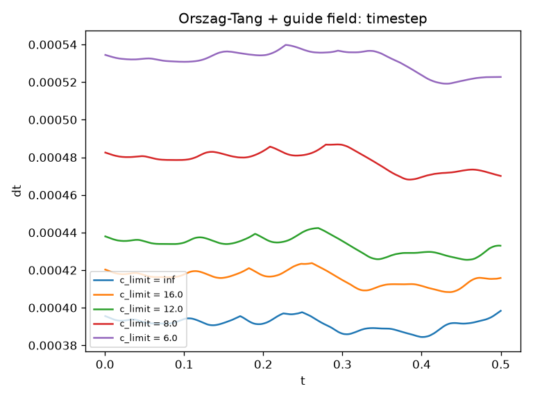

Density:

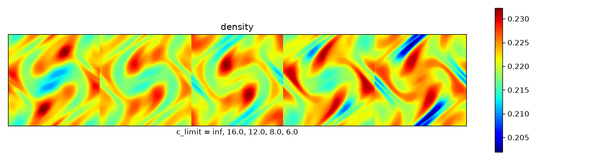

Magnetic pressure:

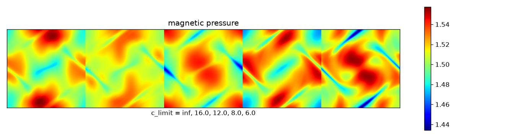

Velocity:

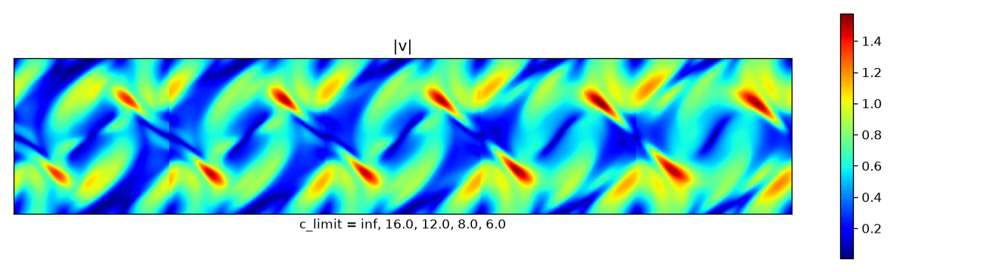

Alfven speed:

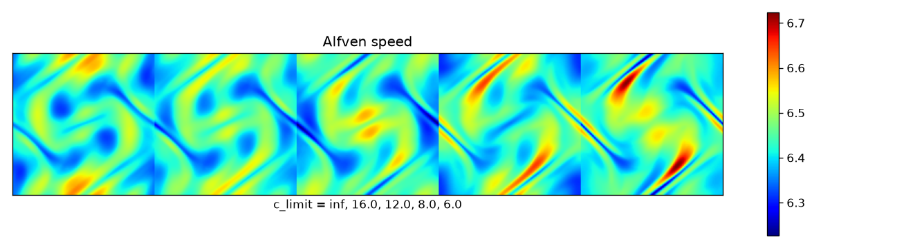

Fast speed:

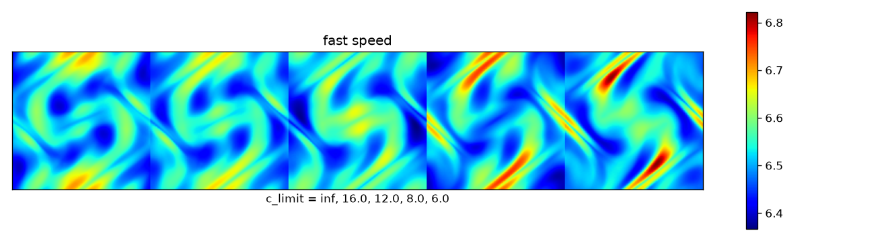


## When it breaks

Two independent conditions bound how small `c_limit` can go. Both are checked at
runtime and warned about.

1. **Semi-relativistic ordering**, `|v| < 0.5 c`. Matsumoto et al. find stability
   degrades beyond this. Problem 1 violates it for every `c_limit` in the sweep
   (`v_max ~ 1.6`).
2. **Energy consistency.** The scheme evolves a modified momentum but keeps the
   *ideal-MHD* energy, dropping the electric-field energy `~ rho_A |v|^2 / 2`.
   Once that is no longer small compared with the thermal energy `p/(gamma-1)`,
   the pressure recovery fails and `p` goes negative.

Condition 2 predicts the observed thresholds well: it is marginal at
`c_limit = 1.8` for problem 1 and at `c_limit = 6` for problem 4, and both go
negative at the next step down (1.6 and 5 respectively). For problem 4 it is the
*binding* constraint -- stricter than the `|v| < 0.5c` rule.


## Notes on the implementation

- Riemann solvers: `hll` (default) and `llf` both carry the Boris correction --
  Boris-corrected signal speeds, and dissipation applied to the Boris conserved
  state. `hlld` is the ideal-MHD solver only and is refused for a finite
  `c_limit` (its Boris generalization is the subject of Matsumoto et al. and is
  not implemented here).
- The face-normal field in each Riemann problem is the single-valued,
  constrained-transport face field, so no spurious `div B` monopole force enters.
- Reconstruction is on *gas* pressure, not total pressure, which matters a lot at
  the low beta where Boris is used.
- The signal speed is the directional fast speed, not the isotropic bound
  `sqrt(a^2 + v_A^2)`.
- `--galilean` switches on a Galilean-invariant variant of the correction; see
  below.


## Galilean invariance

The Boris correction as published is **not Galilean invariant**. Expanding the
momentum equation,

```math
M \frac{\partial \mathbf{v}}{\partial t}
 + \rho\,(\mathbf{v}\cdot\nabla)\mathbf{v}
 + \mathbf{v}\,\frac{\partial \rho_A}{\partial t}
 = -\nabla p_T + \nabla\cdot(\mathbf{B}\mathbf{B}),
\qquad M = \rho + \rho_A ,
```

`rho_A` multiplies `dv/dt` but not the advection `(v.grad)v`. This is not a bug
in the implementation -- `E x B / c^2` is a Lorentz-covariant momentum, and the
correction is exactly as Galilean-invariant as relativity is.

The consequence is not academic. Boost the frame by `U` and the Alfven speed
measured *relative to the fluid* solves `M d^2 + U rho_A d - B_n^2 = 0`, so the
two roots stop being symmetric. Run with `--boost U` to see it (problem 2,
`c_limit = 0.5`, where the invariant answer is -0.4454):

| boost `U` | 0 | 0.25 | 0.5 | 1.0 |
|---|---|---|---|---|
| as published | -0.4455 | -0.5669 | -0.6937 | -0.9069 |
| `--galilean` | -0.4455 | -0.4455 | -0.4454 | -0.4452 |

At `U ~ v_A` the speed cap is undone entirely: no speedup, and a wrong answer.

`--galilean` carries the Boris inertia through the momentum flux as well
(`rho_B v v` in place of `rho v v`), which turns the expansion into

```math
M \frac{D\mathbf{v}}{Dt}
 + \mathbf{v}\left[\frac{D\rho_A}{Dt} + \rho_A \nabla\cdot\mathbf{v}\right]
 = -\nabla p_T + \nabla\cdot(\mathbf{B}\mathbf{B}) .
```

The frame dependence vanishes wherever `rho_A` is advected like a mass density
-- exactly so for a circularly polarized Alfven wave, which is why the table
above is flat to 0.04%. It stays in conservation form, the wave speeds are
unchanged (`c_f^B = gamma_A c_f` still), and convergence is still 2nd order.

What it costs and buys, at identical `c_limit`:

| problem | c_limit | speedup | change (published) | change (`--galilean`) |
|---|---|---|---|---|
| Orszag-Tang | 2.4 | 1.02x | 10.8% | **6.7%** |
| Orszag-Tang | 1.6 | 1.01x | 21.6% | **13.4%** |
| Alfven wave | 0.5 | 2.24x | 1.6% | 1.6% |
| OT + guide field | 6.0 | 1.35x | 2.2% | **1.5%** |

Orszag-Tang improves most, which makes sense -- it has the strongest flows, so
the non-invariant term `rho_A (v.grad)v` is largest there. Pressure positivity
is mixed rather than uniformly better: problem 1 at `c_limit = 1.6` stays
positive with `--galilean` where the published form goes negative, but problem 4
at `c_limit = 5` is somewhat worse.

A residual `v [Drho_A/Dt + rho_A div(v)]` survives wherever the field is
compressed or amplified. Removing that too means evolving `rho_A` as its own
advected variable,

```math
\frac{\partial \rho_A}{\partial t} + \nabla\cdot(\rho_A \mathbf{v}) = S,
\qquad
\frac{\partial (M\mathbf{v})}{\partial t}
 + \nabla\cdot(M\mathbf{v}\mathbf{v} + p_T\mathbb{I} - \mathbf{B}\mathbf{B})
 = \mathbf{v}\,S,
\qquad
S = -\frac{\rho_A - |\mathbf{B}|^2/c^2}{\tau},
```

which is Galilean covariant for any `tau` (the source `v S` is just the momentum
carried by created or destroyed virtual mass). That is not implemented here.

The underlying trade-off: you can have **conservation form**, **Galilean
invariance**, and **`rho_A` tied instantaneously to `|B|`** -- pick two.
`--galilean` is off by default so that the default really is equations (1)--(8)
of Matsumoto et al. None of this touches the energy inconsistency above, which
is an independent constraint.


## The Boris method

Ideal MHD drops the displacement current from Ampere's law. Keeping it, but with
an artificially reduced speed of light `c`, adds the electromagnetic momentum
`E x B / c^2` (with `E = -v x B`) to the fluid momentum. The result is a
"semi-relativistic" system whose Alfven speed saturates at `c` instead of growing
without bound as the field gets strong -- which is exactly what wrecks the
timestep in low-beta regions.

The conservative system solved here is

```math
\frac{\partial \mathbf{U}}{\partial t} + \nabla \cdot \mathbb{F} = 0,
\qquad
\mathbf{U} =
\begin{pmatrix}
  \rho \\
  (\rho + \rho_A)\,\mathbf{v} \\
  \mathbf{B} \\
  e
\end{pmatrix},
\qquad
\mathbb{F} =
\begin{pmatrix}
  \rho \mathbf{v} \\
  \rho \mathbf{v}\mathbf{v} + p_T \mathbb{I} - \mathbf{B}\mathbf{B} \\
  \mathbf{v}\mathbf{B} - \mathbf{B}\mathbf{v} \\
  (e + p_T)\mathbf{v} - (\mathbf{B}\cdot\mathbf{v})\,\mathbf{B}
\end{pmatrix}
```

with the Boris inertia, total pressure and total energy

```math
\rho_A \equiv \frac{|\mathbf{B}|^2}{c^2} = \rho\,\frac{v_A^2}{c^2},
\qquad
v_A^2 = \frac{|\mathbf{B}|^2}{\rho},
\qquad
p_T = p + \frac{|\mathbf{B}|^2}{2},
\qquad
e = \frac{p}{\gamma - 1} + \frac{1}{2}\rho|\mathbf{v}|^2 + \frac{|\mathbf{B}|^2}{2}.
```

**Only the momentum in `U` changes; every flux is the ideal-MHD one.** The exact
semi-relativistic momentum is anisotropic,

```math
\mathbf{S} = \rho\mathbf{v} + \frac{\mathbf{E}\times\mathbf{B}}{c^2}
           = \rho\mathbf{v}
             + \frac{|\mathbf{B}|^2\mathbf{v} - (\mathbf{v}\cdot\mathbf{B})\mathbf{B}}{c^2},
```

i.e. only the motion *across* the field gains inertia. Matsumoto et al. use the
isotropic approximation that drops the `(v.B)B` term, which is what is
implemented here. Because `rho_A` depends only on `B`, recovering `v` from the
conserved momentum is an explicit division -- no iteration, unlike relativistic
MHD.

All wave speeds are reduced by the Boris factor

```math
\gamma_A = \frac{1}{\sqrt{1 + v_A^2/c^2}} \;\longrightarrow\; \frac{c}{v_A}
\quad\text{as}\quad v_A \gg c ,
```

so the Alfven and fast magnetosonic speeds along a face normal `n` become

```math
c_A^{B} = \gamma_A\, v_{A,n},
\qquad
c_f^{B} = \gamma_A \sqrt{
  \tfrac{1}{2}\left(
    a^2 + v_A^2 + \sqrt{(a^2 + v_A^2)^2 - 4 a^2 v_{A,n}^2}
  \right)},
```

```math
a^2 = \frac{\gamma p}{\rho},
\qquad
v_{A,n} = \frac{B_n}{\sqrt{\rho}} .
```

These are used both for the Riemann solver signal speeds and for the timestep

```math
\Delta t = C_{\rm CFL}\,
\min_{\rm cells} \frac{\Delta x}{|\mathbf{v}| + \max\!\left(c_{f,x}^{B},\, c_{f,y}^{B}\right)} .
```

The speedup is therefore `~ 1/gamma_A` **only when the fast speed sets the CFL
limit**. As soon as `|v|` dominates the denominator the correction buys nothing,
which is precisely what happens in plain Orszag-Tang.

Validity requires both

```math
|\mathbf{v}| \lesssim \tfrac{1}{2} c
\qquad\text{and}\qquad
\tfrac{1}{2}\rho_A |\mathbf{v}|^2 \ll \frac{p}{\gamma - 1}
\quad\Longleftrightarrow\quad
\frac{v_A^2 |\mathbf{v}|^2}{c^2} \ll \frac{2 a^2}{\gamma(\gamma - 1)} ,
```

the first from the semi-relativistic ordering, the second because the
ideal-MHD energy is retained while the momentum is modified.
